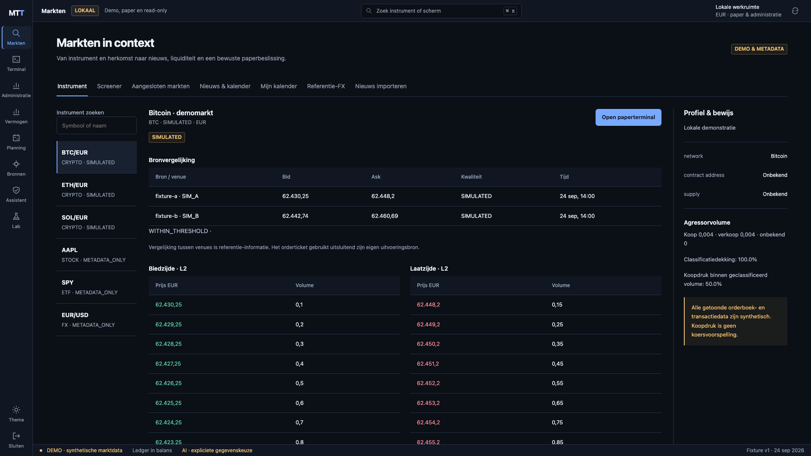
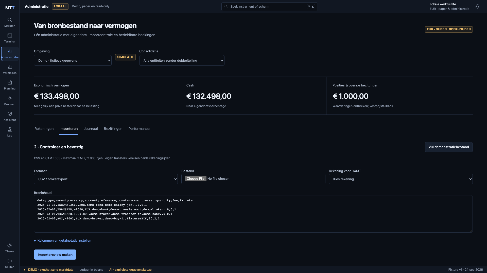
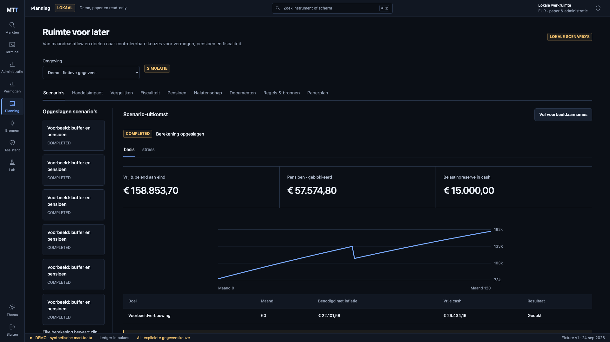
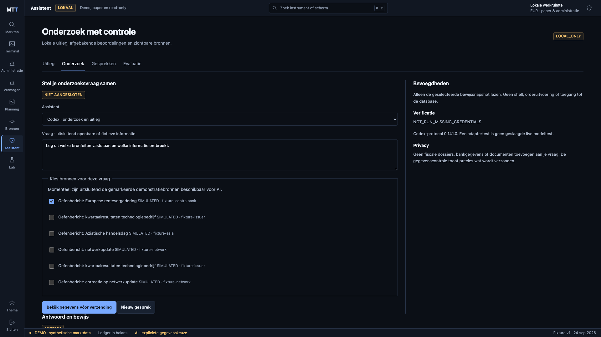
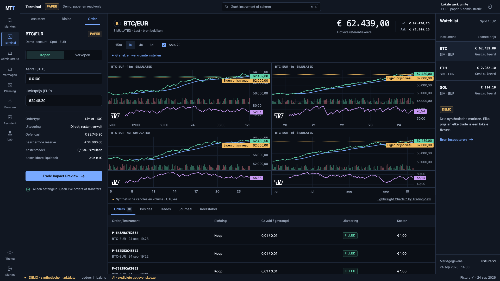

# M2–M5 acceptatiebewijs · 0.5.0

Ontwerp vooraf: `c8ca586`. Functionele implementatie, contracts en tests: `7af54c9`. M0/M1 historisch bewijs blijft in [M0](M0.md) en [M1](M1.md). Browserbeelden onder dezelfde bestandsnamen zijn bij de release vernieuwd; historische beelden blijven via Git beschikbaar.

De onderstaande regels zijn **IMPLEMENTED** en **TESTED_WITH_FIXTURES** binnen hun omschreven scope. Externe model/feedverificatie is apart, niet DONE door een mock. De status en niet-gebouwde uitbreidingen staan in [STATUS](../../STATUS.md).

| ID | Werkende slice / bewijs | Grens |
|---|---|---|
| M2.1 | Coinbase quote/trade/L2, transport-subscribe, maker/taker en sequence-tests | Geen echte streamtest |
| M2.2 | Alpaca feedrechten, quotes/trades/correcties/cancels/bars | Geen credentials/live entitlementtest |
| M2.3 | Strikte vergelijkbaarheid + referentie-FX | ECB niet voor executie; fixturedata |
| M2.4 | RSS/Atom/JSON, rechten, canonical URL, kopclusters, bronfamilie en revisies | Geen betaalde nieuwsdienst; exacte clustering |
| M2.5 | DST/sessies/feestdagen/early close + lokale kalender en monitoringgap | Externe agenda fixture; geen notificaties buiten app |
| M2.6 | Crypto/aandeel/ETF/FX-profielen, SEC filed/revisiecontract, splits | Fundamentals/holdings onbekend zonder echte bron |
| M2.7 | L2 snapshot/delta/resync, dedup, onbekende side/coverage | Oude correcties buiten begrensd venster expliciet ontbrekend |
| M2.8 | SourceHealth, prioriteiten, entitlement/stale/disconnect | Geen bewezen automatische livefailover naar equivalent bron |
| M3.1 | Entiteiten, ownershipcycles/percentages, eliminaties | Gebruiker bevestigt economische eigendom |
| M3.2 | CSV/CAMT preview/review/confirm, atomic/idempotent imports | Eigen bronmapping voor broker-CSV; geen banklogin |
| M3.3 | Journal, cash, dividend, fees, markt/FX-resultaat, waardering, reversal, TWR/IRR | Histories worden niet uit huidige koers verzonnen |
| M3.4 | Doelen/maandcashflow, bewaarde basis/stress/Monte Carlo | Begrensd aannamemodel, geen prognose |
| M3.5 | Ruleset + Box 1/2/3, officiële voorbeelden en scopeguards | 2025, concept; menselijke review ontbreekt |
| M3.6 | UPO/Factor A/WTP, jaarruimte/reserveringsruimte/bewijs, apart pensioenkapitaal | Geen automatische AOW/actuariële uitkering |
| M3.7 | Account/entity/scenarioversie-gebonden handelsimpact | EUR-account, geen orderbevoegdheid |
| M4.1 | Gepinde schemas, echte offline stdio-init, gemockte auth/resume/stream | Echte modelturns ontbreken |
| M4.2 | Drie beperkte tools, context-/broncontrole, denied shell/submit | Geen persoonlijke financiële cloudcontext |
| M4.3 | Jev officiële HTTP choice/noul/score, timeout/rate/error ABSTAIN | Geen echte leveranciercall; Node-adapter in geïsoleerde bridge |
| M4.4 | Gelabelde set, per-taakmetrics/coverage/MAE/drift | Synthetische voorspellingen bewijzen pipeline, geen modelkwaliteit |
| M4.5 | Evidencepaneel, bron- en numerieke referentievalidatie | Geen bewijs dat vrije interpretatie waar is |
| M4.6 | LOCAL_ONLY-default, preview/consent, persistente request/reserveringslimieten | Lokale budgetten zijn geen harde providerfactuurlimiet |
| M4.7 | Promptinjectie, secret/scope, onverwachte tool/approval, foutgetallen | Geen volledige onafhankelijke red-teamaudit |
| M5.1 | Echte controle 12 officiële bronnen, hashbinding, menselijke review | Mislukte crawl afzonderlijk bewaard; geen autonome fiscaliteit |
| M5.2 | Scenario-/tax/pensioenvergelijking met invoerverschil en versie | Gelijke scope/horizon of calculator vereist |
| M5.3 | Estateverdeling/review + encrypted vault/version/download | Geen testament of juridische automatisering |
| M5.4 | Cursor/first-available replay, volgende-bar backtest + uitgebreide tutorial | Uitsluitend synthetische historie |
| M5.5 | 500.000 events, p50/95/99, sequence-/disconnect-/revisiontests | Lokale browserharness, geen live-netwerkprestatieclaim |
| M5.6 | Nieuwe DB-restore, documenten/hashcontrole, corrupte ciphertext, kalendergap | Handmatige lokale backup; geen off-device test |
| M5.7 | Chromium/WebKit, axe, vijf formaten, licht/donker/reduced motion/keyboard | Zie fidelity-log; geen certificering |
| M5.8 | Verse installatie, README + installatie/gebruiks/provider/tax/privacy/restorehandleidingen | macOS/arm64 bewezen |

## Reproduceren

Vanuit de projectmap, met afzonderlijke QA op 4187:

```sh
rtk proxy python3 scripts/setup-local.py --qa
rtk proxy env WEB_PORT=4187 docker compose -p wpos-mtt-qa -f infra/compose/compose.yaml up --build -d --wait
rtk proxy env WEB_PORT=4187 docker compose -p wpos-mtt-qa -f infra/compose/compose.yaml exec -T api python -m pytest tests -q -p no:cacheprovider
rtk proxy docker compose -f infra/compose/compose.yaml -f infra/compose/ai.yaml --profile ai build assistant
rtk proxy docker run --rm --network none wpos-mtt-assistant:0.5.0 npm test
rtk proxy python3 scripts/run-browser-tests.py
rtk proxy .venv/bin/python scripts/benchmark.py
rtk proxy .venv/bin/ruff check services/api/app services/api/tests scripts
rtk proxy npm --prefix apps/web run lint
rtk proxy npm --prefix apps/web run build
rtk proxy python3 scripts/generate-contracts.py
rtk proxy .venv/bin/python scripts/export-api-contracts.py
rtk proxy cargo check --locked --manifest-path packages/contracts/rust/Cargo.toml
```

Voor fresh install en restore: [INSTALLATION](../runbooks/INSTALLATION.md), [BACKUP_RESTORE](../runbooks/BACKUP_RESTORE.md). De broncontrole is reproduceerbaar via Planning → Regels & bronnen → officiële bronnen controleren; echte downloadinhoud kan later wijzigen.

## Resultaten

- [115 backendtests, checks/logs](release-checks.json) en [12 geïsoleerde adaptertests](release-check-5.txt).
- [13 browserproeven geslaagd, één expliciete WebKit-loadskip](e2e-results.json).
- [Echte Codex-initialisatie zonder netwerk/model](codex-offline-initialize.json).
- [Optionele diensten zonder geactiveerde providers](optional-profiles.json).
- [500.000 events / 50.000 bookupdates / geen onbekend verlies](stream-performance.json); [warm financieel snapshot](performance.json).
- [Verse installatie](fresh-install.json); [tien tabellen en zeven documenten hersteld](backup-restore-m5.json).
- [Gebruikersgegevens vóór/na upgrade](upgrade-preservation.json); [containerdigests](release-images.json).
- [Officiële bronnen succesvol](source-check.json); [eerste fout correct geregistreerd](source-check-initial.json).

## Browserbeelden







Meer formaten en WebKit-beelden staan in `screenshots/`. Zie [visuele vergelijking](../design/fidelity-log.md). Alleen synthetische/lege testomgevingen zijn gefotografeerd.
